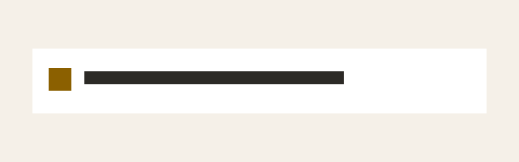

# Component Inventory

| Component | Seen in | Status | Priority | Fingerprint summary | Required tokens | Missing states / modes | Notes |
|---|---|---|---|---|---|---|---|
| Notice | S01, S02 | extracted | P1 | Inline message with a label | color, type, shape | none | Present in both captures |

## Component Similarity Review

| New candidate | Similar existing component | Visual reference | Similarity reason | Suggested action | Developer decision | Rationale / owner |
|---|---|---|---|---|---|---|
| Compact Notice | Notice |  | Same anatomy with tighter spacing. | make variant | make variant | Density is a mode of the same component. |
